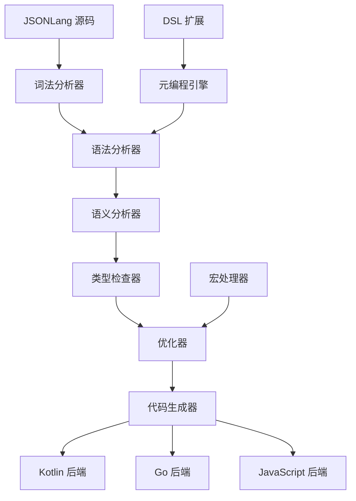

# JSONLang 中文规范设计文档

## 概述

JSONLang 是一个基于 JSON 格式的现代编程语言，旨在结合 JSON 的简洁性和现代编程语言的表达力。本设计文档定义了 JSONLang 的完整语言规范，包括语法结构、类型系统、模块系统、元编程能力以及多后端支持。

### 设计原则

1. **代码即数据** - 利用 JSON 的结构化特性，使代码本身就是可操作的数据
2. **多后端兼容** - 设计与后端无关的抽象，支持编译到 Kotlin、Go、JavaScript
3. **元编程友好** - 提供强大的元编程能力，支持 DSL 创建
4. **类型安全** - 提供静态类型检查和类型推导
5. **中文友好** - 完整支持中文开发体验

## 架构

### 整体架构



### 编译流程

1. **词法分析** - 将 JSON 文本转换为 Token 流
2. **语法分析** - 构建抽象语法树（AST）
3. **语义分析** - 符号解析和作用域分析
4. **类型检查** - 静态类型验证和推导
5. **优化** - AST 优化和宏展开
6. **代码生成** - 生成目标后端代码

## 组件和接口

### 核心数据结构

#### JSONLang 文件结构

```json
{
  "metadata": {
    "name": "模块名称",
    "version": "1.0.0",
    "description": "模块描述",
    "author": "作者",
    "license": "MIT",
    "target": ["kotlin", "go", "javascript"],
    "encoding": "utf-8"
  },
  "imports": {
    "模块别名": {
      "source": "模块来源",
      "version": "版本号",
      "items": ["导入项列表"],
      "alias": "别名映射"
    }
  },
  "exports": {
    "导出名称": {
      "type": "导出类型",
      "visibility": "可见性",
      "target": "导出目标"
    }
  },
  "types": {
    "类型名称": {
      "kind": "类型种类",
      "definition": "类型定义",
      "constraints": "类型约束",
      "annotations": "注解"
    }
  },
  "constants": {
    "常量名称": {
      "type": "常量类型",
      "value": "常量值",
      "visibility": "可见性"
    }
  },
  "functions": {
    "函数名称": {
      "modifiers": "修饰符",
      "generics": "泛型参数",
      "parameters": "参数列表",
      "return": "返回类型",
      "body": "函数体",
      "annotations": "注解"
    }
  },
  "macros": {
    "宏名称": {
      "parameters": "宏参数",
      "expansion": "宏展开",
      "phase": "展开阶段"
    }
  },
  "dsl": {
    "DSL名称": {
      "syntax": "语法定义",
      "semantics": "语义定义",
      "transformation": "转换规则"
    }
  }
}
```

#### 类型系统设计

```json
{
  "types": {
    "基础类型": {
      "String": { "kind": "primitive", "size": "dynamic" },
      "Int": { "kind": "primitive", "size": 32, "signed": true },
      "Long": { "kind": "primitive", "size": 64, "signed": true },
      "Float": { "kind": "primitive", "size": 32 },
      "Double": { "kind": "primitive", "size": 64 },
      "Boolean": { "kind": "primitive", "values": [true, false] },
      "Unit": { "kind": "primitive", "description": "空类型" },
      "Any": { "kind": "primitive", "description": "顶级类型" },
      "Nothing": { "kind": "primitive", "description": "底级类型" }
    },
    "复合类型": {
      "Array<T>": {
        "kind": "generic",
        "parameters": ["T"],
        "operations": ["get", "set", "length", "push", "pop"]
      },
      "Object<K, V>": {
        "kind": "generic",
        "parameters": ["K", "V"],
        "constraints": { "K": "String | Symbol" }
      },
      "Function<Args, Return>": {
        "kind": "generic",
        "parameters": ["Args", "Return"]
      },
      "Optional<T>": {
        "kind": "generic",
        "parameters": ["T"],
        "values": ["Some(T)", "None"]
      }
    },
    "用户定义类型": {
      "结构体": {
        "kind": "struct",
        "fields": {
          "字段名": {
            "type": "字段类型",
            "optional": false,
            "default": "默认值"
          }
        }
      },
      "枚举": {
        "kind": "enum",
        "variants": {
          "变体名": {
            "value": "变体值",
            "associated": "关联数据类型"
          }
        }
      },
      "联合类型": {
        "kind": "union",
        "types": ["类型1", "类型2", "类型3"]
      }
    }
  }
}
```

#### 函数系统设计

```json
{
  "functions": {
    "示例函数": {
      "modifiers": {
        "visibility": "public",
        "async": false,
        "inline": false,
        "pure": true
      },
      "generics": {
        "T": {
          "constraints": ["Comparable"],
          "default": null
        }
      },
      "parameters": [
        {
          "name": "参数名",
          "type": "参数类型",
          "optional": false,
          "default": "默认值",
          "annotations": ["@NotNull"]
        }
      ],
      "return": {
        "type": "返回类型",
        "nullable": false
      },
      "body": [
        {
          "type": "variable_declaration",
          "name": "变量名",
          "type": "变量类型",
          "value": "初始值"
        },
        {
          "type": "conditional",
          "condition": "条件表达式",
          "then": "then分支",
          "else": "else分支"
        },
        {
          "type": "loop",
          "kind": "for",
          "iterator": "迭代器",
          "iterable": "可迭代对象",
          "body": "循环体"
        },
        {
          "type": "try_catch",
          "try": "try块",
          "catch": [
            {
              "exception": "异常类型",
              "handler": "处理器"
            }
          ],
          "finally": "finally块"
        },
        {
          "type": "return",
          "value": "返回值"
        }
      ],
      "annotations": [
        {
          "name": "注解名",
          "parameters": "注解参数"
        }
      ]
    }
  }
}
```

### 模块系统设计

#### 导入机制

```json
{
  "imports": {
    "标准库导入": {
      "jsonlang": {
        "source": "stdlib",
        "version": "1.0.0",
        "items": ["*"]
      }
    },
    "文件导入": {
      "math": {
        "source": "./math.lang.json",
        "items": ["add", "subtract", "multiply"],
        "alias": { "add": "加法" }
      }
    },
    "包导入": {
      "http": {
        "source": "package:jsonlang-http",
        "version": "^2.0.0",
        "items": ["Client", "Server"],
        "target": ["kotlin", "javascript"]
      }
    },
    "条件导入": {
      "platform_specific": {
        "source": "./platform.lang.json",
        "condition": {
          "target": "kotlin"
        }
      }
    }
  }
}
```

#### 导出机制

```json
{
  "exports": {
    "公共函数": {
      "type": "function",
      "name": "publicFunction",
      "visibility": "public"
    },
    "类型导出": {
      "type": "type",
      "name": "CustomType",
      "visibility": "public"
    },
    "默认导出": {
      "type": "default",
      "value": "defaultExport"
    },
    "命名空间导出": {
      "type": "namespace",
      "name": "MyNamespace",
      "items": ["function1", "function2"]
    }
  }
}
```

### 元编程系统设计

#### 宏系统

```json
{
  "macros": {
    "简单宏": {
      "parameters": ["name", "type"],
      "expansion": {
        "type": "function",
        "name": "${name}",
        "return": { "type": "${type}" },
        "body": [
          {
            "type": "return",
            "value": {
              "type": "literal",
              "value": "Hello, ${name}!"
            }
          }
        ]
      },
      "phase": "compile_time"
    },
    "语法宏": {
      "parameters": ["condition", "body"],
      "syntax": "unless ${condition} { ${body} }",
      "expansion": {
        "type": "conditional",
        "condition": {
          "type": "unary_op",
          "operator": "!",
          "operand": "${condition}"
        },
        "then": "${body}"
      }
    }
  }
}
```

#### DSL 支持

```json
{
  "dsl": {
    "SQL查询DSL": {
      "syntax": {
        "select": {
          "pattern": "SELECT ${fields} FROM ${table} WHERE ${condition}",
          "fields": ["fields", "table", "condition"]
        }
      },
      "semantics": {
        "select": {
          "type": "function_call",
          "function": "sql_query",
          "arguments": ["${fields}", "${table}", "${condition}"]
        }
      },
      "transformation": {
        "target": "kotlin",
        "template": "sqlQuery(\"${fields}\", \"${table}\", \"${condition}\")"
      }
    },
    "HTML模板DSL": {
      "syntax": {
        "element": {
          "pattern": "<${tag} ${attributes}>${content}</${tag}>",
          "fields": ["tag", "attributes", "content"]
        }
      },
      "semantics": {
        "element": {
          "type": "object",
          "properties": {
            "tag": "${tag}",
            "attributes": "${attributes}",
            "content": "${content}"
          }
        }
      }
    }
  }
}
```

### 多后端支持设计

#### 后端抽象接口

```json
{
  "backends": {
    "kotlin": {
      "type_mapping": {
        "String": "String",
        "Int": "Int",
        "Float": "Float",
        "Boolean": "Boolean",
        "Array<T>": "List<T>",
        "Object<K,V>": "Map<K,V>",
        "Optional<T>": "T?"
      },
      "function_mapping": {
        "main": "fun main()",
        "async": "suspend fun",
        "lambda": "{ ${params} -> ${body} }"
      },
      "import_mapping": {
        "stdlib": "import kotlinx.serialization.*"
      }
    },
    "go": {
      "type_mapping": {
        "String": "string",
        "Int": "int",
        "Float": "float64",
        "Boolean": "bool",
        "Array<T>": "[]T",
        "Object<K,V>": "map[K]V",
        "Optional<T>": "*T"
      },
      "function_mapping": {
        "main": "func main()",
        "async": "go func()",
        "lambda": "func(${params}) ${return} { ${body} }"
      }
    },
    "javascript": {
      "type_mapping": {
        "String": "string",
        "Int": "number",
        "Float": "number",
        "Boolean": "boolean",
        "Array<T>": "T[]",
        "Object<K,V>": "Record<K,V>",
        "Optional<T>": "T | null"
      },
      "function_mapping": {
        "main": "function main()",
        "async": "async function",
        "lambda": "(${params}) => ${body}"
      }
    }
  }
}
```

## 数据模型

### AST 节点定义

```kotlin
// Kotlin 中的 AST 节点定义示例
sealed class ASTNode {
    abstract val location: SourceLocation
    abstract val annotations: List<Annotation>
}

data class Program(
    val metadata: Metadata,
    val imports: List<ImportDeclaration>,
    val exports: List<ExportDeclaration>,
    val types: List<TypeDeclaration>,
    val constants: List<ConstantDeclaration>,
    val functions: List<FunctionDeclaration>,
    val macros: List<MacroDeclaration>,
    val dsls: List<DSLDeclaration>,
    override val location: SourceLocation,
    override val annotations: List<Annotation>
) : ASTNode()

data class FunctionDeclaration(
    val name: String,
    val modifiers: FunctionModifiers,
    val generics: List<GenericParameter>,
    val parameters: List<Parameter>,
    val returnType: Type,
    val body: List<Statement>,
    override val location: SourceLocation,
    override val annotations: List<Annotation>
) : ASTNode()

sealed class Statement : ASTNode()
sealed class Expression : ASTNode()
sealed class Type : ASTNode()
```

### 类型系统模型

```kotlin
sealed class Type {
    data class Primitive(val name: String) : Type()
    data class Generic(val name: String, val parameters: List<Type>) : Type()
    data class Function(val parameters: List<Type>, val returnType: Type) : Type()
    data class Struct(val fields: Map<String, Type>) : Type()
    data class Enum(val variants: Map<String, Type?>) : Type()
    data class Union(val types: List<Type>) : Type()
    data class Optional(val innerType: Type) : Type()
}
```

## 错误处理

### 错误类型定义

```json
{
  "error_types": {
    "语法错误": {
      "code": "SYNTAX_ERROR",
      "message": "语法错误：${details}",
      "severity": "error",
      "recoverable": false
    },
    "类型错误": {
      "code": "TYPE_ERROR", 
      "message": "类型错误：期望 ${expected}，实际 ${actual}",
      "severity": "error",
      "recoverable": false
    },
    "导入错误": {
      "code": "IMPORT_ERROR",
      "message": "导入错误：无法找到模块 ${module}",
      "severity": "error",
      "recoverable": true
    },
    "宏展开错误": {
      "code": "MACRO_ERROR",
      "message": "宏展开错误：${details}",
      "severity": "error",
      "recoverable": true
    }
  }
}
```

### 错误恢复策略

1. **语法错误恢复** - 跳过错误 token 直到找到同步点
2. **类型错误恢复** - 插入类型转换或使用 Any 类型
3. **导入错误恢复** - 使用默认导入或跳过导入
4. **宏错误恢复** - 跳过宏展开，保留原始代码

## 测试策略

### 单元测试

1. **词法分析器测试** - 测试 Token 生成的正确性
2. **语法分析器测试** - 测试 AST 构建的正确性
3. **类型检查器测试** - 测试类型推导和检查
4. **代码生成器测试** - 测试各后端代码生成

### 集成测试

1. **端到端编译测试** - 完整的编译流程测试
2. **多后端兼容性测试** - 确保各后端生成代码的一致性
3. **元编程测试** - 测试宏和 DSL 功能
4. **性能测试** - 编译性能和运行时性能测试

### 示例测试用例

```json
{
  "test_cases": {
    "基础功能测试": {
      "input": {
        "functions": {
          "add": {
            "parameters": [
              {"name": "a", "type": "Int"},
              {"name": "b", "type": "Int"}
            ],
            "return": {"type": "Int"},
            "body": [
              {
                "type": "return",
                "value": {
                  "type": "binary_op",
                  "operator": "+",
                  "left": {"type": "identifier", "name": "a"},
                  "right": {"type": "identifier", "name": "b"}
                }
              }
            ]
          }
        }
      },
      "expected_kotlin": "fun add(a: Int, b: Int): Int = a + b",
      "expected_go": "func add(a int, b int) int { return a + b }",
      "expected_js": "function add(a, b) { return a + b; }"
    }
  }
}
```